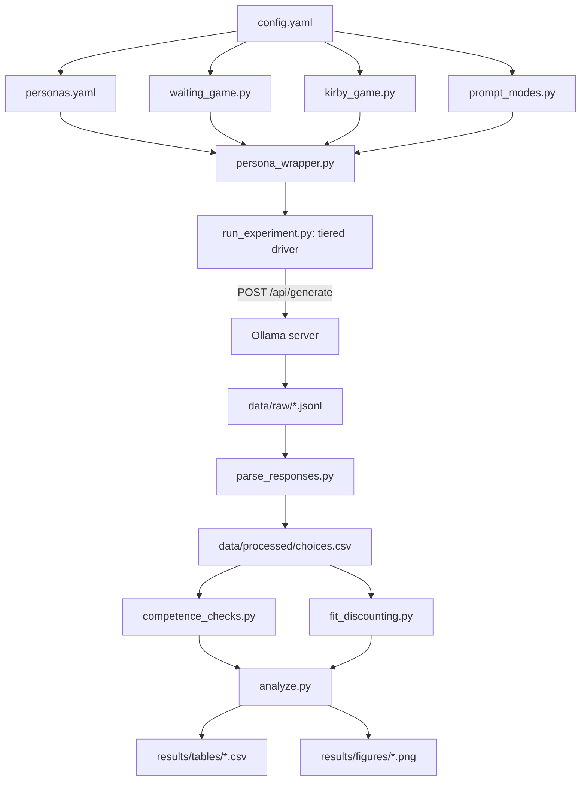

# Phase 1 Extended (Phase 1b): Multi-Instrument, Multi-Model Discounting Pipeline

## Phase framing decision

These additions (more models, prompt-mode axis, Kirby-27, personas) all still produce the same output the master research design calls "Phase 1": a validated discount-rate measurement per model/condition. None of them touch the Phase 2 reward-hacking outcome battery. This is therefore **Phase 1 Extended (Phase 1b)** — a broadened version of the same phase, not a new phase 2. Phase 2 remains reserved for the reward-hacking correlational/causal work from the original master plan.

## What's new vs. the original Phase 1 plan

| Axis | Original Phase 1 | Phase 1 Extended |
|---|---|---|
| Models | 3x Qwen2.5 (1.5b/3b/7b-instruct) | + 3x Qwen3 (1.7b/4b/8b), matched size classes for architecture comparison |
| Instruments | Waiting Game only | + Kirby MCQ-27 (fixed, validated, human-normed) |
| Prompting | Zero-shot only | + one-shot, two-shot, chain-of-thought conjoint |
| Persona | None | Toggleable age persona (teenager / middle-aged / senior), roleplay frame |
| Sample budget | N=30 per condition | N=30 (zero/one/two-shot), N=10 x 2 calls (CoT, cost-reduced per literature precedent) |

## Confirmed scope (from clarifying answers)

- **Models:** `qwen2.5:1.5b-instruct`, `qwen2.5:3b-instruct`, `qwen2.5:7b-instruct`, `qwen3:1.7b`, `qwen3:4b`, `qwen3:8b`.
- **Prompt modes:** zero-shot, one-shot, two-shot, chain-of-thought (CoT) conjoint.
- **Personas:** age triad only (teenager, middle-aged, senior citizen) plus a no-persona baseline = 4 conditions, roleplay frame only. Income and smoking/addiction personas explicitly deferred (see Notes).
- **Instruments:** Waiting Game (49-cell grid, unchanged from original Phase 1) + Kirby MCQ-27 (new).
- **Compute allocation:** full cross-product of model x instrument x prompt_mode x persona (per your choice), with a staged execution order to de-risk the resulting long runtime (see Compute Budget section).

## Kirby MCQ-27 Module: Experimentally Robust Design

### Verified item set
Sourced and cross-validated from two independent citations of the original [Kirby, Petry & Bickel (1999)](https://doi.org/10.1037/0096-3445.128.1.78) Table 1: the item text/amounts/delays from the standard [MCQ instrument PDF](http://fmwww.bc.edu/repec/bocode/m/mcq_instrument.pdf) and the magnitude/k-value assignments from [Kaplan et al. (2016), "Automating Scoring of Delay Discounting..."](https://doi.org/10.1007/s40614-016-0070-9). All 27 rows cross-checked between sources (magnitude bands align: Small LDR $25-35, Medium LDR $50-60, Large LDR $75-85).

`kirby27_items.yaml` will contain all 27 rows, e.g.:

| # | SIR | LDR | Delay (days) | k at indiff. | Magnitude |
|---|---|---|---|---|---|
| 1 | $54 | $55 | 117 | .000158 | Medium |
| 4 | $31 | $85 | 7 | .248848 | Large |
| 11 | $11 | $30 | 7 | .246753 | Small |
| 13 | $34 | $35 | 186 | .000158 | Small |
| 27 | $20 | $55 | 7 | .250000 | Medium |
| ... | ... | ... | ... | ... | ... (full 27 rows in the config file) |

### Administration procedure
- Present each item as "A. \$X today / B. \$Y in N days" with SIR/LDR randomly assigned to slot A vs B per trial (same order-bias control as the Waiting Game).
- Because LLM responses are stochastic (unlike the single-shot human paper instrument), sample each item **N=30 times at temperature=1**, yielding an empirical P(choose LDR) per item rather than a single binary response.

### Scoring (two methods, both reported)
1. **Standard hand/consistency method** ([Kirby, 2000](https://doi.org/10.1901/jeab.2000.73-243); implemented per [Kaplan et al. 2016 "MCQ Scorer"](https://doi.org/10.1007/s40614-016-0070-9)): binarize each item by its modal (>50%) sampled choice, then find the k-value with maximum consistency across all 27 items; if tied, take the geometric mean of the tied candidates. Report `small_k`, `medium_k`, `large_k`, and `geomean_k` (composite), directly comparable to published human population percentile norms ([Kirby, 2009](https://doi.org/10.3758/BF03192828)).
2. **Probabilistic logistic method** (adapting [Wileyto et al., 2004](https://doi.org/10.1016/j.drugalcdep.2003.10.012)): instead of binarizing, fit a logistic regression of the sampled P(LDR) against the closed-form log-odds covariate implied by each item's `(SIR, LDR, delay)`, weighted by N, giving a continuous k with a bootstrap 95% CI. This avoids the information loss of binarizing stochastic LLM outputs and is the primary quantity used for statistical comparison across models/conditions; the hand-scoring method above is retained purely for direct comparability to human normative tables.
- **Data-quality flag:** report the consistency score per model/condition; following [Kaplan et al. (2016)](https://doi.org/10.1007/s40614-016-0070-9)'s convention, flag any run with consistency <75% as low-quality/unreliable.
- **Magnitude-effect check:** report whether `small_k > medium_k > large_k` (the classic human magnitude effect — more patience for larger rewards) as an explicit human-likeness test per model/condition.

### Contamination control (Kirby-specific risk)
The MCQ-27's exact wording is extremely widely reproduced online (it's a famous, publicly available clinical instrument), so verbatim administration risks eliciting memorized response patterns rather than a computed preference — a different and arguably worse contamination risk than the Waiting Game's synthetic grid. Mitigation: administer a **paraphrased-text variant** (same dollar amounts/delays, reworded question framing) alongside the verbatim version, and compare fitted k between the two. Large verbatim-vs-paraphrase divergence is evidence of memorization/pattern-matching rather than a genuine preference computation; this variant is generated once and cached (not regenerated per run) to keep it fixed across models for comparability. (Note: dollar amounts/delays must stay fixed since the instrument's k-values are calibrated to them; only surface phrasing is varied, unlike the Waiting Game's "zorbs" nonce-currency control, which isn't applicable here.)

### Convergent validity
Central deliverable: correlate each model's Kirby-27 `geomean_k` against its independently-fit Waiting Game `k` across all models/conditions (Pearson + Spearman). This is the direct empirical test of whether "LLM discount rate" is a stable, instrument-independent construct or a method-specific artifact (per the field's documented discrepancy between behavioral-conjoint studies and mechanistic-interpretability studies on this exact question).

## Prompt-Mode Module

- **Zero-shot:** current default — no exemplar, single-turn choice.
- **One-shot:** prepend one exemplar trial with an answer. The exemplar must be **trivially decidable by magnitude** (e.g. "A. \$10 in 10 years / B. \$1,000,000 now -> B") so it teaches response format/consistency without smuggling in a target discount rate.
- **Two-shot:** two exemplars, one trivially favoring "now" (tiny gain from waiting) and one trivially favoring "later" (enormous gain from waiting) — a balanced pair, mirroring the balanced gain/loss exemplar design in [Ross, Kim & Lo (2024)](https://arxiv.org/abs/2408.02784) sec. 4.
- **Chain-of-thought (CoT) conjoint** (per [Goli & Singh, 2023](https://arxiv.org/abs/2305.02531) sec. 2.4): two-call procedure per trial — Call 1 asks the model to "think step by step and explain your reasoning, then state your choice"; Call 2 feeds Call 1's output back and asks it to extract only the final A/B choice. Sampled at **N=10** (not 30) per condition, matching Goli & Singh's own cost-driven reduction for CoT sampling. Doubles the call count per trial (reasoning + extraction).
- **Qwen3 native thinking mode (assumption to confirm):** Qwen3 models default to an internal `<think>` reasoning mode on Ollama. To keep zero/one/two-shot conditions comparable across model families, thinking will be **explicitly disabled** (`/no_think` directive) for those three modes, and **explicitly enabled** only for the CoT condition — mapping Qwen3's native reasoning mode onto the same `prompt_mode=cot` condition used for Qwen2.5. Flagging this now since it's a real design choice not covered by your last answer; correct me if you'd rather leave Qwen3 thinking on by default across all modes.

## Persona Module

- **Axis:** age only, 3 levels + baseline (no-persona), roleplay frame only (advice-giving frame deferred).
- **Wording:** adapted directly from the validated system-prompt pattern in [Ross, Kim & Lo (2024)](https://arxiv.org/abs/2408.02784) Table 13 ("Imagine that you are a teenager... Remember that you are a teenager and should act according to your preferences as a teenager"), re-templated onto the Waiting Game / Kirby-27 instructions instead of their gambling-game instructions.
- **Predicted direction (pre-registered hypothesis):** per [Green, Fry & Myerson (1994), "Discounting of delayed rewards: A life-span comparison," Psychological Science](https://doi.org/10.1111/j.1467-9280.1994.tb00625.x), human discount rate decreases with age — so the pre-registered prediction is `k(teenager) > k(middle-aged) > k(senior)`. Testing whether LLMs reproduce this ordering is itself a "human-likeness of heterogeneity" check, in the same spirit as the language-FTR check in [Goli & Singh](https://arxiv.org/abs/2305.02531) and the age-roleplay check in [Ross et al.](https://arxiv.org/abs/2408.02784) (who found mixed/non-monotonic results, so this is a genuine open replication, not a foregone conclusion).
- **Deferred (Phase 1c):** income-level persona ([Green, Myerson & Ostaszewski, 1999](https://doi.org/10.3758/BF03209424)), smoking/addiction persona ([Bickel, Odum & Madden, 1999](https://doi.org/10.1007/s002130050945); [Barlow et al., 2016](https://doi.org/10.1093/ije/dyw233)), advice-giving frame, and a disposition (impulsive vs. disciplined) manipulation-check persona.

## Updated Project Structure

```
temporal-discounting/
  config.yaml                    # models, instruments, prompt_modes, personas, grids, N
  personas.yaml                  # persona_id -> {system_prompt_fragment, citation, predicted_direction}
  kirby27_items.yaml             # verified 27-item table (SIR, LDR, delay, k, magnitude)
  requirements.txt
  PREREGISTRATION.md             # updated with new hypotheses (convergent validity, magnitude effect, age ordering)
  src/
    ollama_client.py             # + Qwen3 think-mode control (/no_think), per-family model routing
    waiting_game.py              # unchanged
    kirby_game.py                # NEW: renders 27 items (verbatim + paraphrased variant), order randomization
    prompt_modes.py               # NEW: exemplar injection (one/two-shot) + CoT two-call orchestration
    persona_wrapper.py            # NEW: composes persona fragment + frame onto any instrument's prompt
    run_experiment.py             # UPDATED: model x instrument x prompt_mode x persona x cell x N, resumable, tiered
    parse_responses.py           # unchanged
    competence_checks.py         # + Kirby consistency-score gating (<75% flag)
    fit_discounting.py           # + Kirby hand-scoring method + probabilistic logistic method
    analyze.py                    # + convergent-validity correlation, magnitude-effect check, persona-direction check
  data/
    raw/{model}__{instrument}__{mode}__{persona}.jsonl
    processed/choices.csv         # long-format: model, instrument, mode, persona, cell/item, order, choice
  results/
    tables/discount_rates.csv     # k + CI + consistency flag per model x instrument x mode x persona
    tables/convergent_validity.csv
    figures/discount_curves.png
    figures/persona_direction.png
```

## Compute Budget & Staged Execution

Full cross-product size: 6 models x 4 personas x (Waiting Game 49 cells + Kirby-27 27 items = 76 cells) x prompt modes:
- Zero/one/two-shot: 6 x 3 x 4 x 76 x 30 = **164,160 calls**
- CoT: 6 x 1 x 4 x 76 x 10 x 2 = **36,480 calls**
- **Total ~200,600 generate calls.** At an optimistic 1-2 sec/call average on an 8GB M2 (larger models slower), this is realistically **multiple days** of continuous local runtime, not hours.

To make this tractable and produce usable results incrementally, execute in tiers (same final scope, just sequenced so partial results are available early and the run can be paused/resumed via the existing checkpointing):

| Tier | Scope | Calls | Purpose |
|---|---|---|---|
| 1 | Zero-shot, no persona, all 6 models, both instruments | ~13,680 | Core Phase 1 replication on the expanded model set; validates Kirby module and convergent validity first |
| 2 | + persona axis (zero-shot only) | ~41,040 | Age-ordering hypothesis test |
| 3 | + one-shot, two-shot (no persona) | ~27,360 | Prompt-mode sensitivity, no persona confound |
| 4 | Remaining full cross-product (personas x one/two-shot, all CoT) | ~118,560 | Completes the design |

## Pipeline Flow



## Steps

1. Verify and load the Kirby-27 item table into `kirby27_items.yaml`; spot-check against both cited sources.
2. Scaffold updated `config.yaml`, `personas.yaml`, `PREREGISTRATION.md` with all new axes and pre-registered hypotheses (convergent validity direction, magnitude effect, age ordering).
3. Update `ollama_client.py` for the 6-model roster and Qwen3 think-mode control.
4. Implement `kirby_game.py` (verbatim + paraphrased variants, order randomization).
5. Implement `prompt_modes.py` (one/two-shot exemplar injection; CoT two-call orchestration with N=10).
6. Implement `persona_wrapper.py` and the age-persona prompt fragments.
7. Update `run_experiment.py` for the full model x instrument x mode x persona grid with tiered/resumable execution.
8. Update `competence_checks.py` (add Kirby consistency-score gating) and `fit_discounting.py` (add both Kirby scoring methods).
9. Update `analyze.py`: convergent-validity correlation table, magnitude-effect check, persona-direction check, contamination (paraphrase) comparison.
10. Pilot (N=3) across both instruments on `qwen2.5:1.5b-instruct` before committing to Tier 1.
11. Execute Tiers 1-4 in order, inspecting results after each tier before proceeding.

## Notes / Deferred Items
- Income-level and smoking/addiction personas, and the advice-giving frame, deferred to Phase 1c per your "3 or less personas for now" guidance.
- Qwen3 think-mode handling (disabled for zero/one/two-shot, enabled for CoT) is a flagged assumption, not explicitly confirmed by you yet.
- No mechanistic/activation access needed here; Phase 3 (steering) will still require switching to a HF/transformers or MLX backend.
