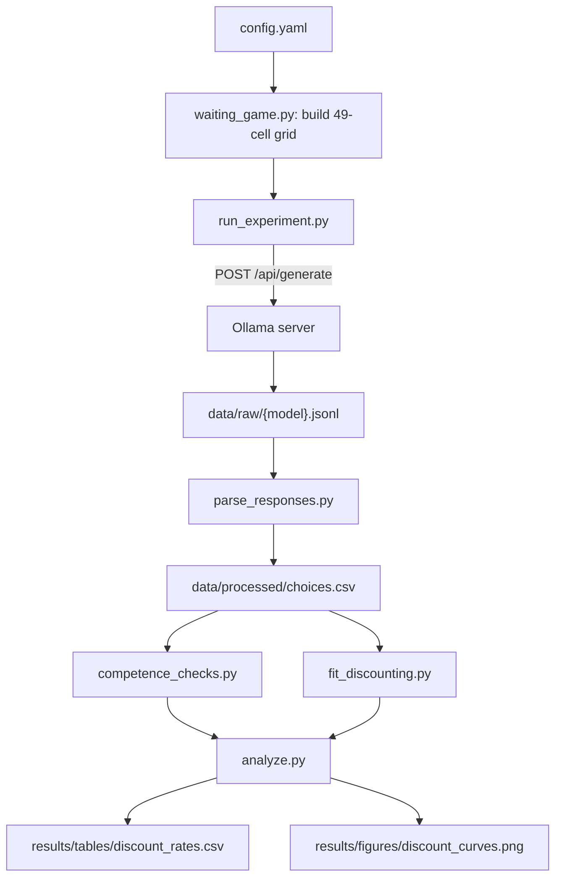

# Phase 1 Plan: Waiting Game Discounting Pipeline on Local Qwen Models

## Confirmed scope (from clarifying answers)
- Runtime: Ollama HTTP API (`http://localhost:11434`), assumed already running with models pulled.
- Models: `qwen2.5:1.5b-instruct`, `qwen2.5:3b-instruct`, `qwen2.5:7b-instruct`.
- Paradigm: Waiting Game only for this pass (Rachlin et al. 1991 design, as replicated in [Ross, Kim & Lo (2024)](https://arxiv.org/abs/2408.02784)). Kirby MCQ-27 and Chain-of-Thought Conjoint deferred to a later pass once this pipeline is validated.
- Sample budget: N=30 completions per condition (reduced from the literature's N=100 for local feasibility).

## Experimental design

For each model, present a forced binary choice repeated across a delay x amount grid:

- **Fixed later option:** "$1000 in `{d}` months"
- **Varying sooner option:** "$`{x}` now"
- **Delay grid `d`:** 1, 3, 6, 12, 24, 60, 120 months (~1mo to 10yr, log-spaced, matching the spirit of Rachlin's 1-month-to-50-year range but truncated for local compute budget)
- **Amount grid `x`:** $0, 150, 300, 450, 600, 750, 900 (7 levels spanning the full $0-$1000 range)
- **Cells:** 7 x 7 = 49 per model
- **Samples per cell:** N=30 at temperature=1 (matches literature's stochastic-sampling approach, e.g. Goli & Singh 2305.02531 sec 2.3)
- **Order control:** randomize which option appears as "A" vs "B" per trial (50/50) to control the known LLM order-position bias ([Ross et al. 2408.02784](https://arxiv.org/abs/2408.02784) Appendix D.3; [Lu et al. 2022](https://arxiv.org/abs/2104.08786))
- **Total generate calls:** 49 cells x 30 samples x 3 models = 4,410 

Prompt template (system + user), matching the literature's minimal-instruction style:

```
System: You are playing a game where you are given two monetary options. You must choose one. When answering, respond with only the letter of the option you choose (A or B). Do not explain your choice.
User: A. {option_A}
B. {option_B}
```

## Project structure

```
temporal-discounting/
  config.yaml                 # models, delay/amount grids, N, temperature, paths
  requirements.txt            # requests, numpy, scipy, pandas, matplotlib, pyyaml, tqdm
  PREREGISTRATION.md          # hypotheses + analysis plan fixed before running
  src/
    ollama_client.py          # thin wrapper: generate(), keep_alive control, retries/timeouts
    waiting_game.py           # builds the 49-cell trial grid + prompt rendering with order randomization
    run_experiment.py         # main driver; resumable (checkpoints completed trials to skip on rerun)
    parse_responses.py        # extract A/B from raw text (regex + fallback), flags unparseable/refusals
    competence_checks.py      # monotonicity check (P(sooner) increases in x) + "prefers money to $0" check
    fit_discounting.py        # scipy.optimize.curve_fit hyperbolic fit U(x,d)=x/(1+k*d) per model, bootstrap CI
    analyze.py                 # cross-model comparison table + discount-curve plots vs. human benchmark k
  data/
    raw/{model}.jsonl          # every raw trial: prompt, order assignment, raw completion, parsed choice
    processed/choices.csv      # long-format parsed data: model, delay, amount, order, choice
  results/
    tables/discount_rates.csv  # fitted k + 95% CI per model, competence pass/fail flags
    figures/discount_curves.png
```

## Pipeline flow



## Steps

1. Scaffold the project directory and `config.yaml` with the grids/models/N above.
2. Implement `ollama_client.py`: calls `/api/generate` with `temperature=1`, short `num_predict` (~5 tokens), timeout/retry handling, and explicit `keep_alive` management so only one model stays resident at a time on the 8GB machine.
3. Implement `waiting_game.py`: generates all 49 cells x order-randomized A/B assignment, renders prompts.
4. Implement `run_experiment.py`: iterates models -> cells -> N=30 samples, writes each raw response to `data/raw/{model}.jsonl` incrementally (resumable: skips trials already logged if the script is restarted, important given multi-hour runtime).
5. Implement `parse_responses.py`: robust extraction of "A"/"B" from completions (handles stray punctuation/whitespace/refusals), logs a parse-failure rate per model.
6. Implement `competence_checks.py`: per model, verify (a) P(choose sooner) is monotonically non-decreasing in `x` for each delay, (b) model doesn't prefer $0 now to positive delayed money. Flag models that fail as "no valid discount rate" per [Ross et al.'s methodology](https://arxiv.org/abs/2408.02784).
7. Implement `fit_discounting.py`: for models passing competence checks, fit hyperbolic `k` via nonlinear least squares on the full choice grid using a discounted-random-utility likelihood (per [Holt & Laury 2002](https://www.jstor.org/stable/3083270) / [Andersen et al. 2008](https://www.jstor.org/stable/40056459), as used in [Goli & Singh](https://arxiv.org/abs/2305.02531) sec 3.3); bootstrap 95% CIs over trials.
8. Implement `analyze.py`: produce a comparison table (k, CI, competence flags per model) and discount-curve plots overlaying the human benchmark k from [Rachlin et al. (1991)](https://europepmc.org/articles/PMC1323057).
9. Run a small pilot (N=3, full grid) end-to-end on `qwen2.5:1.5b-instruct` to validate the full pipeline (prompting, parsing, fitting, plotting) before committing to the full multi-hour run.
10. Execute the full N=30 run across all three models (checkpointed, can run in background), then run analysis and inspect results.

## Notes / deferred items
- Contamination check (nonce-currency "zorbs" control) and the other two paradigms (Kirby MCQ-27, CoT Conjoint) are intentionally deferred to a Phase 1b pass once this pipeline is validated, per the narrowed scope.
- No mechanistic/activation access is needed for this phase since Ollama only exposes text generation; Phase 3 (steering) will require switching the `qwen2.5:*` weights to a HF/transformers or MLX backend with residual-stream access.
